\# Conveyor Control Simulator


A C++17 console application that simulates conveyor control logic,

with automated checks and continuous integration using GitHub Actions.


The project demonstrates state-based control, sensor edge detection,

timer handling, input validation, and regression testing.


\## Features


\- Three controller states: STOPPED, RUNNING, and PAUSED.

\- START and STOP command handling.

\- STOP priority when START and STOP are submitted together.

\- Fresh START press required after STOP when using the button-input API.

\- Part detection on the sensor's rising edge.

\- A 3000 ms processing pause.

\- STOP cancels the pause and prevents automatic restart.

\- Deterministic simulated time for repeatable tests.

\- Console commands for interactive scenarios.

\- 22 automated checks.


\## State transitions

```mermaid

stateDiagram-v2

&#x20;   \[\*] --> STOPPED

&#x20;   STOPPED --> RUNNING: START

&#x20;   RUNNING --> PAUSED: Sensor rising edge

&#x20;   PAUSED --> RUNNING: 3000 ms elapsed

&#x20;   RUNNING --> STOPPED: STOP

&#x20;   PAUSED --> STOPPED: STOP

```





The motor is ON only in RUNNING.


START during PAUSED does not interrupt or reset the pause.

A sensor held active does not trigger repeated pauses.

If the sensor is already active at startup, it must clear and

activate again before it can trigger a pause.


\## Project structure


| Path | Purpose |

|---|---|

| `src/ConveyorController.h` | Controller states, buttons, sensor, and timer logic |

| `src/main.cpp` | Console interface and command validation |

| `tests/controller\_tests.cpp` | Automated controller checks |

| `docs/control-requirements.md` | Initial behavior requirements |

| `.github/workflows/ci.yml` | Automated build and test workflow |


\## Build on Windows with MSVC


Install Visual Studio with the Desktop development with C++ workload.


Open Developer Command Prompt for Visual Studio and navigate to

the repository folder. Create the build directory if it does not exist:


```cmd

mkdir build

```


Build and run the simulator:


```cmd

cl /EHsc /W4 /std:c++17 src\\main.cpp /Fo:build\\main.obj /Fe:build\\conveyor.exe

build\\conveyor.exe

```


Build and run the tests:


```cmd

cl /EHsc /W4 /std:c++17 tests\\controller\_tests.cpp /Fo:build\\controller\_tests.obj /Fe:build\\controller\_tests.exe

build\\controller\_tests.exe

echo %ERRORLEVEL%

```


Run each executable only after its compilation succeeds.


\## Build on Linux with GCC


Requirements: a C++17-capable GCC compiler.


From the repository folder:


```bash

mkdir -p build

g++ -std=c++17 -Wall -Wextra -Wpedantic src/main.cpp -o build/conveyor

g++ -std=c++17 -Wall -Wextra -Wpedantic tests/controller\_tests.cpp -o build/controller\_tests

```


After successful compilation:


```bash

./build/conveyor

./build/controller\_tests

echo $?

```


\## Console commands


| Command | Behavior |

|---|---|

| `start` | Simulate a brief START press |

| `stop` | Simulate a brief STOP press |

| `both` | Simulate START and STOP pressed together; STOP wins |

| `status` | Display controller state and motor output |

| `sensor\_on` | Set the part sensor to active |

| `sensor\_off` | Set the part sensor to inactive |

| `tick <ms>` | Advance simulated time by a non-negative integer number of milliseconds |

| `exit` | Close the application |


Button commands simulate a press followed by release.

Sensor commands leave the sensor at the specified level.


Time advances only through `tick`.

Waiting in real time does not advance the simulation.


\## Example: normal processing pause


Enter these commands in a newly started simulator:


```text

start

sensor\_on

tick 2999

tick 1

```


Expected states:


```text

RUNNING

PAUSED

PAUSED

RUNNING

```


\## Example: STOP during a pause


Enter these commands in a newly started simulator:


```text

start

sensor\_on

tick 1000

stop

tick 2000

```


The final state remains STOPPED. The motor does not restart

when the original pause duration has elapsed.


\## Testing


The test executable currently performs 22 checks covering:


\- Initial state and basic START/STOP behavior.

\- Repeated commands and restart after STOP.

\- Sensor rising-edge detection and reactivation.

\- Pause timing at 2999 ms and 3000 ms.

\- Pause cancellation through STOP.

\- START during a pause.

\- An already-active sensor at startup.

\- Simultaneous START/STOP inputs in all three states.

\- Held START after STOP release and a subsequent fresh press.


Successful execution prints:


```text

Failed tests: 0

```


Exit code `0` indicates success. Exit code `1` indicates that

one or more checks failed.


The tests were also checked against a deliberately incorrect

STOP implementation: two checks failed, then passed after

the correct implementation was restored.


\## Continuous integration


GitHub Actions builds the simulator and test executable on Ubuntu

using GCC, then runs the checks on pushes and pull requests.


Local builds and tests have also been performed on Windows using MSVC.


\## Design notes and limitations


\- This is an educational software simulation, not a controller

&#x20; for real machinery.

\- Motor ON/OFF is a simulated output, not measured motor feedback.

\- Events are processed sequentially. `both` represents simultaneous

&#x20; button inputs within one call.

\- Held-button behavior is tested through `processButtons()`.

\- Direct `start()` and `stop()` methods remain available as

&#x20; low-level operations; they bypass button edge detection.

\- Physical I/O, emergency-stop hardware, sensor debouncing,

&#x20; and real-time scheduling are outside the current scope.

\- Console output shows command results; persistent event logging

&#x20; is not implemented yet.

